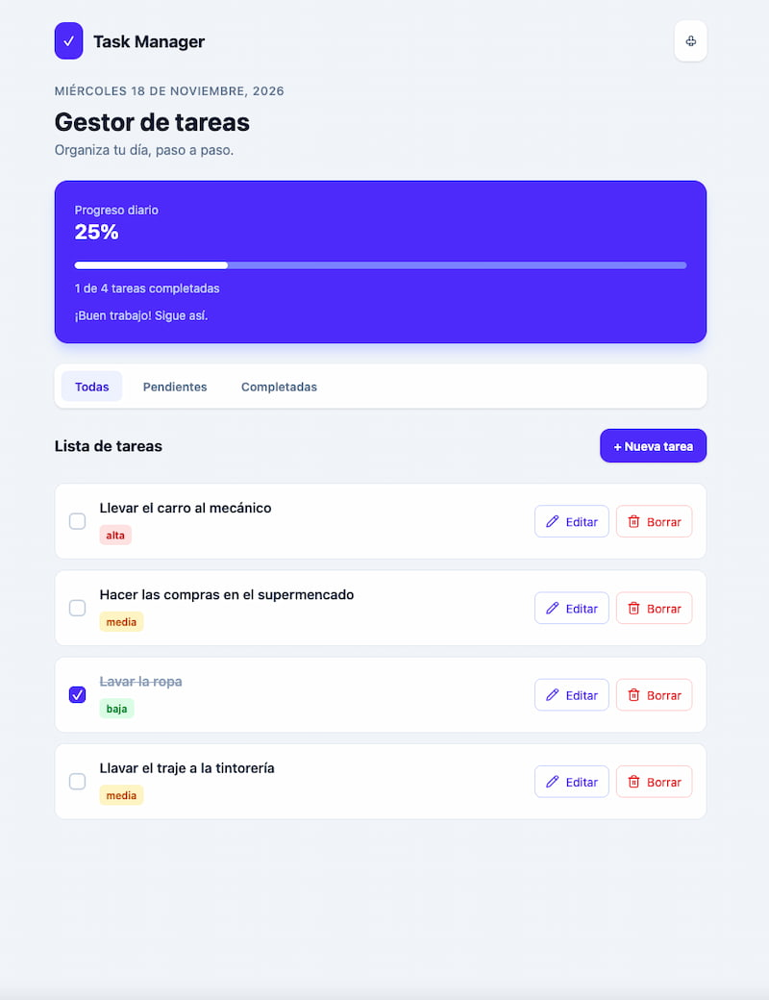

# Task Manager — Gestor de tareas

Aplicación web para gestionar tareas de forma sencilla e intuitiva. Permite crear, editar, eliminar y marcar tareas como completadas, además de asignarles diferentes niveles de prioridad.

Demo: https://taskmanager-arra.netlify.app/

## Características

- Crear nuevas tareas.
- Editar tareas existentes.
- Eliminar tareas.
- Marcar tareas como completadas.
- Asignar prioridades: baja, media y alta.
- Utilizar modales para crear y editar tareas.
- Guardar las tareas en localStorage.
- Recuperar las tareas guardadas al recargar o volver a abrir la aplicación.
- Interfaz responsive y diseño moderno.
- Estilos con Tailwind CSS.
- Tipado estático con TypeScript.
- Hooks personalizados para gestionar el estado de los modales.

## Tecnologías utilizadas

- React — construcción de interfaces de usuario.
- TypeScript — tipado estático y mayor seguridad en el código.
- Tailwind CSS — diseño y estilos de la aplicación.
- Vite — entorno de desarrollo y compilación.
- Lucide React — iconos de la interfaz.
- LocalStorage API — almacenamiento local de las tareas en el navegador.

## Instalación

Clona el repositorio:
`git clone URL_DE_TU_REPOSITORIO`

Entra en la carpeta del proyecto:
`cd NOMBRE_DE_TU_PROYECTO`

Instala las dependencias:
`npm install`

Inicia el servidor de desarrollo:
`npm run dev`

### Persistencia de datos con LocalStorage

La aplicación utiliza localStorage del navegador para guardar las tareas localmente y conservarlas cuando el usuario recarga o vuelve a abrir la página en el mismo navegador.

#### Funcionalidades de almacenamiento

- Guardar las tareas creadas.
- Recuperar las tareas previamente guardadas.
- Actualizar los datos almacenados al editar una tarea.
- Eliminar del almacenamiento las tareas borradas.
- Conservar el estado de las tareas completadas y sus prioridades.
- Ejemplo de implementación

## Conceptos aplicados

Componentes reutilizables en React.
Props y tipado de componentes con TypeScript.
Hooks de React como useState, useEffect y useReducer.
Hooks personalizados para controlar la apertura y el cierre de modales.
Renderizado condicional.
Manejo de formularios controlados.
Creación, edición y eliminación de tareas mediante identificadores.
Persistencia de datos con localStorage.
Conversión de datos a JSON mediante JSON.stringify() y JSON.parse().
Estilizado responsive con clases utilitarias de Tailwind CSS.

## Estado del proyecto

Proyecto en desarrollo, creado con fines de aprendizaje y práctica de React, TypeScript, Tailwind CSS y almacenamiento local en el navegador.

👨‍💻 Autor

Desarrollado por Amairani Romero

Imagen de la palicación:

